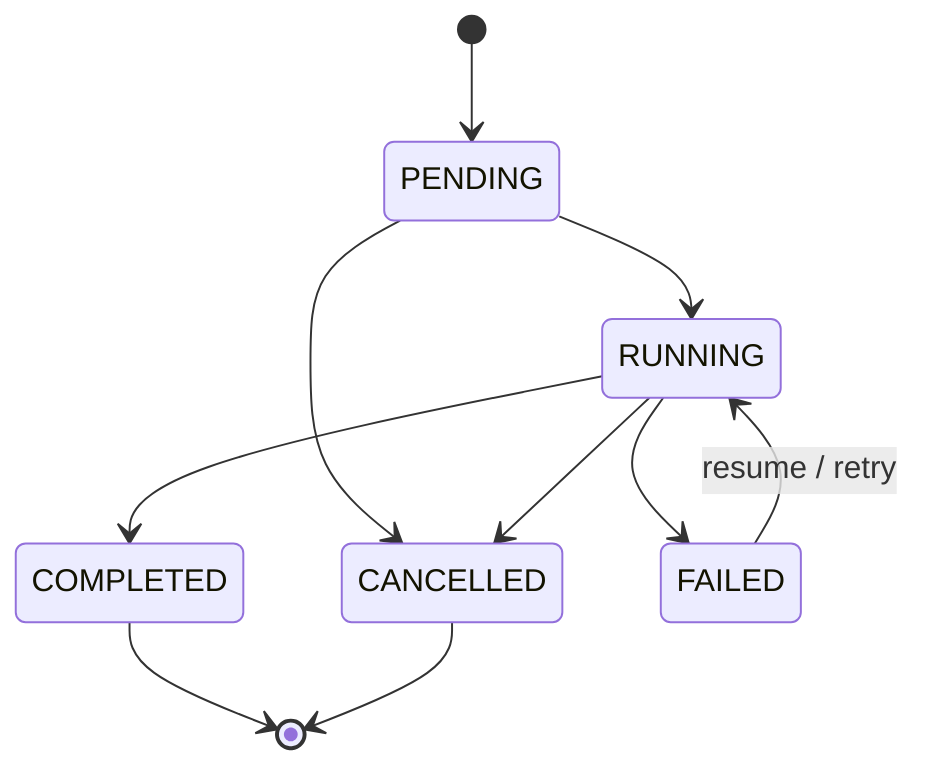
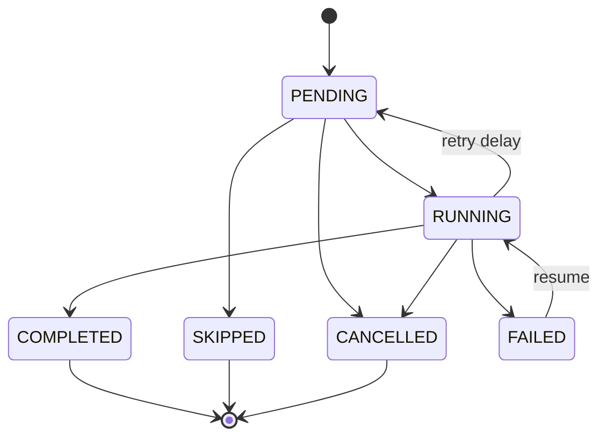

# @durable/engine

Durable workflow execution and orchestration engine for Orbit.

The engine executes workflows step-by-step, persists intermediate outputs, recovers interrupted executions after process crashes, and manages retries, timeouts, and cancellation.

---

## Core Capabilities

1. **Type-Safe Workflow Definitions**: Define workflows with strongly-typed inputs, outputs, and runtime Zod validation.
2. **Durable Step Execution**: Intermediate results are persisted in PostgreSQL. Workflows resume exactly where they were interrupted without repeating completed steps.
3. **At-Least-Once Execution & Idempotency**: Comprehensive guarantees for distributed failure scenarios with deterministic idempotency keys provided to each step execution.
4. **Configurable Retries & Backoff**: Exponential backoff with full jitter and custom error classifiers.
5. **Per-Step Timeouts & Cancellation**: Cooperative cancellation using `AbortSignal` propagated through step execution context.
6. **Optimistic Concurrency Control**: Execution state transitions guard against stale revisions and worker conflicts.

---

## Defining a Workflow

```typescript
import { defineWorkflow } from "@durable/engine";

export interface OrderInput {
  readonly orderId: string;
  readonly amount: number;
}

export const orderWorkflow = defineWorkflow<OrderInput>({
  name: "order-processing",
  version: 1,
  steps: [
    {
      id: "validate-order",
      execute: async (ctx) => {
        ctx.logger.info("Validating order", { orderId: ctx.workflowInput.orderId });
        return { valid: true };
      },
    },
    {
      id: "charge-payment",
      retry: {
        maxAttempts: 3,
        initialDelayMs: 500,
        backoffMultiplier: 2,
        jitter: true,
      },
      timeoutMs: 10000,
      execute: async (ctx) => {
        // Safe external side effect using idempotency key
        const payment = await paymentGateway.charge({
          amount: ctx.workflowInput.amount,
          idempotencyKey: ctx.idempotencyKey,
          signal: ctx.signal,
        });

        return { transactionId: payment.id };
      },
    },
    {
      id: "send-notification",
      execute: async (ctx) => {
        const paymentResult = ctx.getStepOutput<{ transactionId: string }>("charge-payment");
        return { delivered: true, transactionId: paymentResult?.transactionId };
      },
    },
  ],
});
```

---

## Execution Semantics & At-Least-Once Guarantee

### The Two-Generals Problem & Crash Boundaries

In distributed durable execution, there is a fundamental boundary:
1. A worker calls an external side-effecting API (e.g., Stripe, SendGrid, database write).
2. The external service processes the request and responds.
3. Before the worker persists `status: "COMPLETED"` to Orbit storage, the worker process crashes (e.g. OOM, host failure, power cut).

When the workflow resumes:
- The engine inspects storage and discovers the step was still `RUNNING`.
- Orbit **cannot assume the side effect completed**, so the step must be executed again.

> **Semantics Guarantee: At-Least-Once Execution**  
> Orbit guarantees that every step will execute **at least once** until completion or terminal failure. Orbit does not claim exactly-once execution across non-transactional external side effects.

### Using the Idempotency Key

To make at-least-once execution safe, each step execution context provides a deterministic idempotency key:

```text
ctx.idempotencyKey = `${tenantId}:${workflowId}:${runId}:${stepId}:${attempt}`
```

Always forward `ctx.idempotencyKey` to external APIs that support idempotency headers (e.g., `Idempotency-Key: ${ctx.idempotencyKey}`).

---

## Crash Recovery Behavior

When `engine.resume(tenantId, runId, workflow)` is invoked:
1. **Inspection**: The `RecoveryManager` queries storage for existing step records and run status.
2. **Skip Completed Steps**: Any step already marked `COMPLETED` is skipped; its persisted output is placed into the context's step output map.
3. **Resume Interrupted Steps**: If a step was interrupted in `RUNNING` status by a worker crash, the engine increments the attempt counter, emits a `run.recovered_interrupted_step` event, and re-executes the step safely.
4. **Continue Pipeline**: Execution proceeds sequentially through remaining pending steps.

---

## State Transitions

### Workflow Run Transitions


### Workflow Step Transitions


---

## Testing

Run unit tests:
```bash
bun test packages/engine
```

Run integration tests against PostgreSQL:
```bash
bun test tests/integration/engine-recovery.test.ts
```
